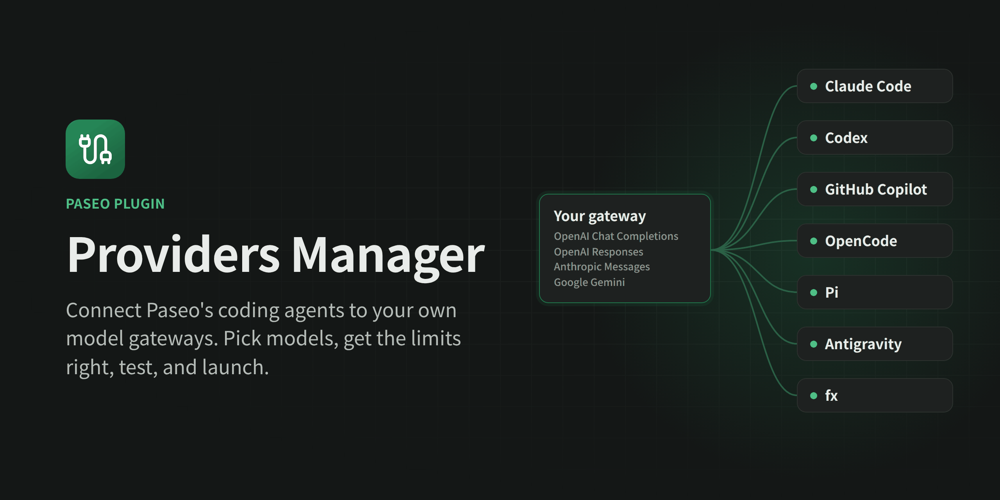
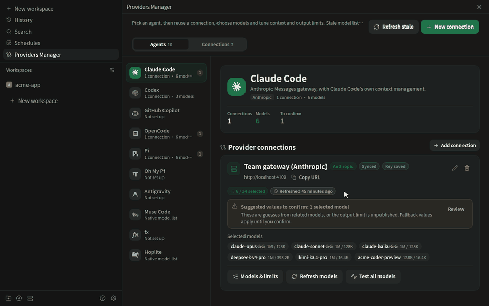
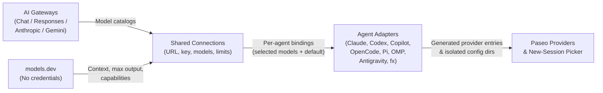
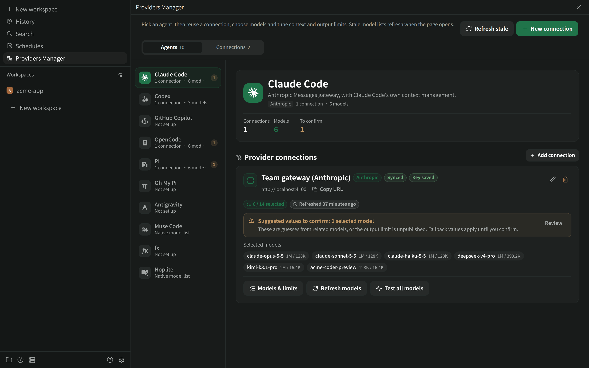
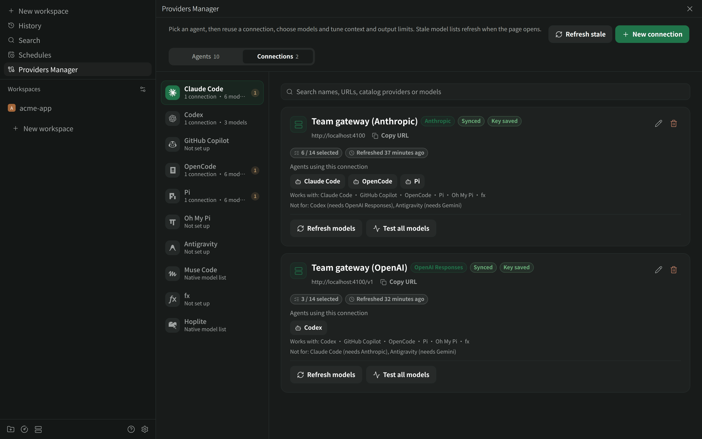
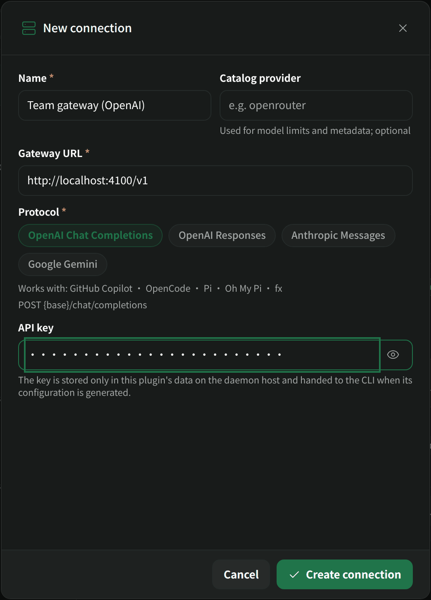
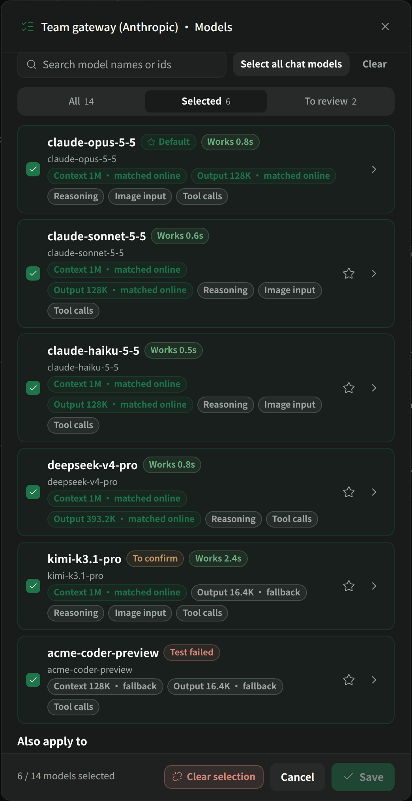
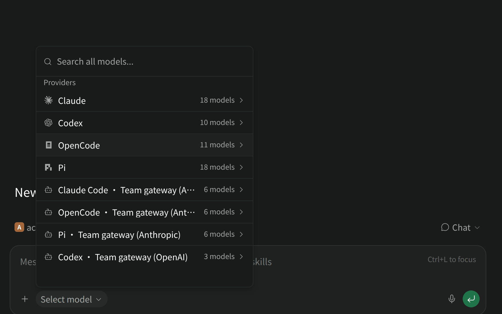

<div align="center">



<p>
  <strong>English</strong> | <a href="./README.zh-CN.md">简体中文</a>
</p>

<p>
  <a href="https://github.com/LucasLan666666/paseo-providers-manager/actions/workflows/ci.yml"></a>
  = 0.17.4" />
  <a href="https://github.com/LucasLan666666/paseo-providers-manager/releases/tag/v0.1.0"></a>
  <a href="./LICENSE"></a>
</p>

<p>
  <strong>Configure shared AI gateway connections once and wire them into every coding agent in <a href="https://paseo.sh">Paseo</a>.</strong><br />
  Discover models automatically, match context windows and output limits from <a href="https://models.dev">models.dev</a>, and generate ready-to-use providers for your new-session picker.
</p>

</div>

---

## Why Providers Manager

Every coding agent CLI stores custom gateways, API keys, and model limits differently — environment variables, JSON catalogs, custom provider files, or isolated config directories. Updating one rotating gateway key or adding a newly released model across Claude Code, Codex, OpenCode, Pi, Oh My Pi, Copilot, Antigravity, and fx quickly becomes repetitive and error-prone.

**Providers Manager** separates **gateway connections** from **per-agent model bindings** inside Paseo:

- **Configure a gateway once, reuse it everywhere** — Store URL, protocol, API key, and model metadata on a shared connection. Updating a URL or key propagates automatically to every agent using it.
- **Per-agent model pickers & defaults** — Each agent chooses its own subset of chat models and default model from any compatible connection, and appears as its own Paseo provider (e.g. `Claude Code · OpenRouter`, `Oh My Pi · Local Gateway`).
- **Automatic `models.dev` limit & capability matching** — Reads each gateway's model catalog and matches context windows, max output tokens, and capabilities (`reasoning`, `image`, `tools`), preferring the upstream vendor's entry.
- **Explicit handling of uncertainty** — Exact matches apply immediately with their source shown; inferred, third-party, or unpublished limits are flagged as **to confirm** so you can adopt them individually or in bulk. Non-chat models (embedding, reranking, image, audio, video) are greyed out.
- **Zero-token validation + live probe tests** — Run **Test all models** to re-read catalogs and verify generated configs using zero tokens, or run **Send test requests** inside the model sheet to probe each selected chat model individually.
- **Zero disruption to running sessions** — Generated config directories stay on disk for a 7-day grace window after changes before automatic pruning, so active agent sessions never lose their configuration mid-run.
- **Bilingual UI** — Follows Paseo's language by default, with a per-device override for **English** or **简体中文**.

## Demo

<div align="center">
  
</div>

*Selecting an agent, reusing an existing gateway connection, picking models with matched limits, and using the generated provider directly in Paseo's new-session picker.*

## How It Works



## Supported Agents

Each agent uses an adapter tailored to how its CLI consumes custom gateways:

| Agent | Supported Protocols | How Providers Manager Connects |
| --- | --- | --- |
| **Claude Code** | Anthropic Messages | Writes custom gateway env config; injects limits only for models Claude Code does not know or manual overrides. |
| **Codex** | OpenAI Responses | Keeps Codex's built-in limits and reasoning efforts for exact bundled models; supports per-connection alias mapping, effort allowlists, and manual overrides in a generated model catalog. |
| **GitHub Copilot** | Chat Completions, Responses, Anthropic Messages | Connects through the Copilot CLI's custom providers configuration file. |
| **OpenCode** | Chat Completions, Responses, Anthropic Messages | Generates per-model limits and capabilities in private config/key files injected on session open so multiple gateways stay isolated. |
| **Pi** | Chat Completions, Responses, Anthropic Messages | Generates per-model context window, max output, and capability entries. |
| **Oh My Pi** | Chat Completions, Responses, Anthropic Messages | Generates per-model context window, max output, and capability entries. |
| **Antigravity** | Gemini | Connects a Gemini-compatible gateway to native `agy` ACP sessions, mapping gateway models onto `agy`'s built-in model names (e.g. `gemini-4-argon`, `gemini-3.1-pro`, with optional `-low`/`-medium`/`-high`/`-xhigh`). |
| **fx** | Chat Completions, Responses, Anthropic Messages | Writes gateway and per-model parameters to fx's `settings.json`. |
| **Muse Code / Hoplite** | Native account catalog | No verifiable custom inference gateway interface; inspect and use their own account/project model lists directly. |

## Screenshots

<table>
  <tr>
    <td width="50%">
      
      <p align="center"><sub><strong>Agent View</strong> — Pick an agent, inspect active connections, and manage per-agent bindings.</sub></p>
    </td>
    <td width="50%">
      
      <p align="center"><sub><strong>Connections Library</strong> — Manage shared gateways, refresh stale catalogs, and see model usage across agents.</sub></p>
    </td>
  </tr>
  <tr>
    <td width="50%">
      
      <p align="center"><sub><strong>Connection Form</strong> — Configure protocol, base URL, API key, and optional catalog provider hint.</sub></p>
    </td>
    <td width="50%">
      
      <p align="center"><sub><strong>Model Sheet</strong> — Review matched limits, adopt suggestions, override values, and send probe tests.</sub></p>
    </td>
  </tr>
</table>

<div align="center">
  
  <p><sub><strong>New-Session Picker</strong> — Enabled agent + connection combinations appear immediately as Paseo providers.</sub></p>
</div>

## Installation

### Prerequisites

- **Paseo `>= 0.17.4`** on the target daemon host.
- **Plugins enabled** on that daemon (**Settings → Plugins → Enable plugins**, or `pluginsEnabled: true` in daemon `config.json`).
- The CLI(s) of the coding agents you plan to use installed on the daemon host.

### Install via CLI (available now)

Install directly from GitHub:

```bash
paseo plugin add git:LucasLan666666/paseo-providers-manager
```

To pin a specific release tag:

```bash
paseo plugin add git:LucasLan666666/paseo-providers-manager --ref v0.1.0
```

Verify the plugin is running:

```bash
paseo plugin ls
```

### Install from the Paseo App

1. Open **Settings → Plugins** on your target host.
2. Paste `git:LucasLan666666/paseo-providers-manager` into **Plugin source**.
3. Click **Install plugin**.

> **Paseo Plugin Registry**: This plugin has been submitted to the official registry (`getpaseo/plugins`). Once reviewed and published on [paseo.sh/plugins](https://paseo.sh/plugins), you will also be able to install the reviewed pin with `paseo plugin add LucasLan666666/providers-manager`.

## Quick Start

1. **Open Providers Manager** from the Paseo sidebar (**Providers Manager**) or via the Command Center (`Providers Manager`).
2. **Add a gateway connection** under an agent (or in the **Connections** tab): enter a name, protocol, base URL, and API key. Saving automatically fetches the gateway's model list and matches limits via `models.dev`.
3. **Choose models** for the agent: pick the chat models you want in Paseo's new-session picker, set a default model, adopt or adjust any **to confirm** limits, and optionally click **Send test requests** to verify end-to-end inference.
4. **Start a session**: open Paseo's new-session picker — your new provider (named `<Agent> · <Connection>`) is ready to use.

## Configuration & Behavior

### Gateway URL conventions

- **OpenAI-compatible protocols** (`chat`, `responses`): URLs are used **exactly as entered**. The plugin never appends `/v1` automatically.
- **Anthropic & Gemini protocols** (`anthropic`, `gemini`): Accept either the host root or a versioned base URL; the adapter appends their standard API paths (`/v1/messages`, `/v1beta/models`) as expected by their clients.

### Model limits, defaults & refreshes

- **OpenAI pricing tier**: OpenAI models default to the `272K` context pricing tier, with a per-model toggle to use the full window.
- **Fallback limits**: Models unknown to both the gateway and `models.dev` use the connection's configurable fallback (`128K` context / `16K` max output by default).
- **Manual overrides**: Manually entered limits always take precedence. If an online catalog value changes later, the UI lets you compare both values and choose. Automatic max output is capped below the context window.
- **Stale catalogs**: Connections not refreshed for more than **24 hours** are marked stale and automatically refreshed when you open the manager.

### Language settings

Go to **Settings → Plugins → Providers Manager** (or run **Providers Manager language** in the Command Center) to choose **Follow Paseo**, **English**, or **简体中文**. The preference is saved per device.

## Data & Security

- **Key storage**: Connection API keys are stored in plain text inside the daemon host's restricted plugin data directory (`$PASEO_HOME/plugin-data/paseo-providers-manager/`). Generated CLI launch configurations in Paseo's config or generated local directories may also contain the key required by the respective CLI.
- **No key exposure to UI**: Saved API keys are never returned to the Paseo client UI.
- **Safe duplication**: Duplicating a connection only carries over the saved API key when the target URL shares the exact same host and port.
- **Outbound requests**: Gateways receive model-list requests, user-triggered probe requests, and normal inference traffic from enabled agents. `models.dev` metadata lookups are sent without any credentials.
- **Directory cleanup**: When a provider configuration changes, old generated directories remain for **7 days** so running sessions stay intact, after which the plugin prunes unreferenced directories automatically.

## Development

```bash
git clone https://github.com/LucasLan666666/paseo-providers-manager.git
cd paseo-providers-manager
npm install
npm run typecheck
npm test
```

To test your local checkout on a Paseo daemon:

```bash
paseo plugin install /absolute/path/to/paseo-providers-manager
paseo plugin ls
```

### Project layout

```text
├── paseo-plugin.json     # Plugin manifest, listing metadata & translations
├── OVERVIEW.md           # Paseo plugin registry overview (English)
├── OVERVIEW.zh-CN.md     # Paseo plugin registry overview (Simplified Chinese)
├── index.client.tsx      # Paseo client entry (screen, sidebar, command center, settings)
├── index.server.ts       # Paseo daemon server entry (RPC handlers)
├── client/               # Cross-platform React Native UI components & state hooks
├── server/               # Gateway catalog fetcher, models.dev matcher, agent adapters, storage
├── shared/               # Shared Zod RPC contracts, protocol definitions, limits & i18n
├── tests/                # Unit & integration tests (tsx --test)
└── assets/               # Plugin icon, banners, screenshots & demo GIFs
```

## License

Released under the [MIT License](./LICENSE).
