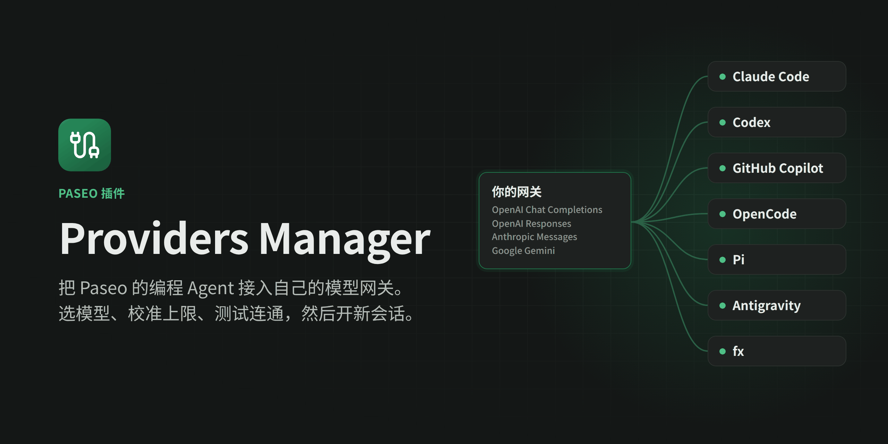
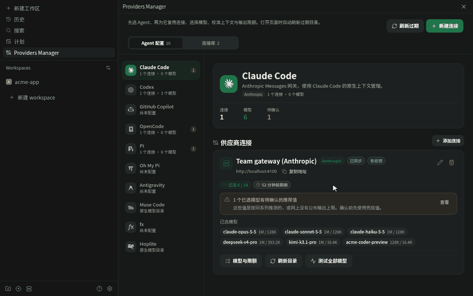
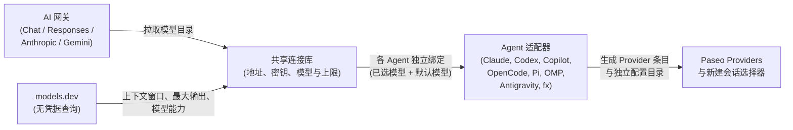
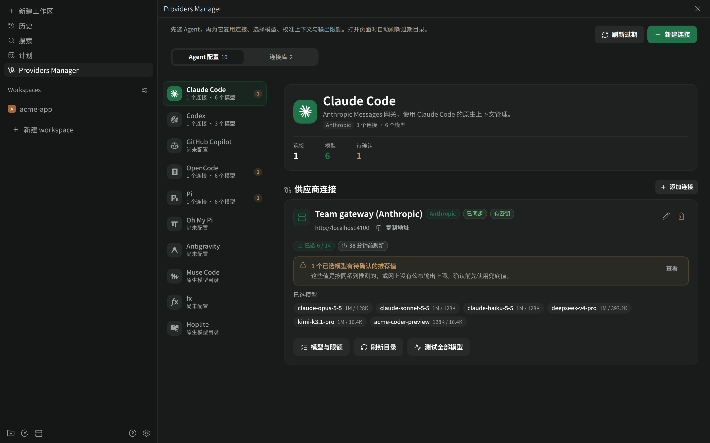
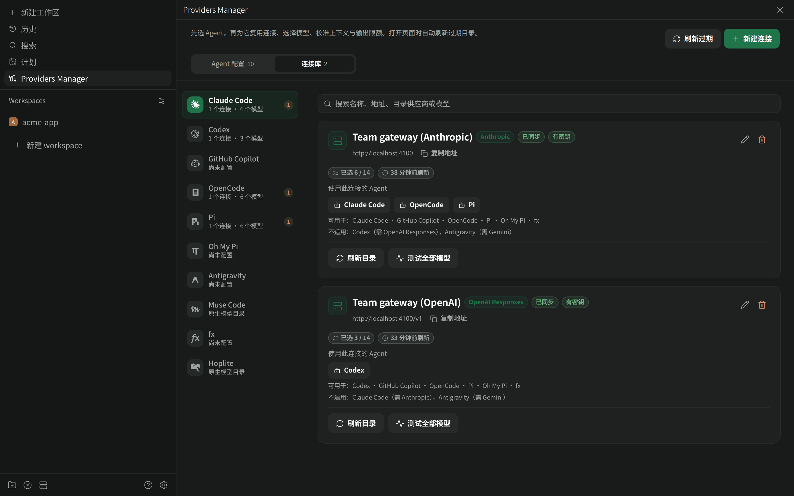
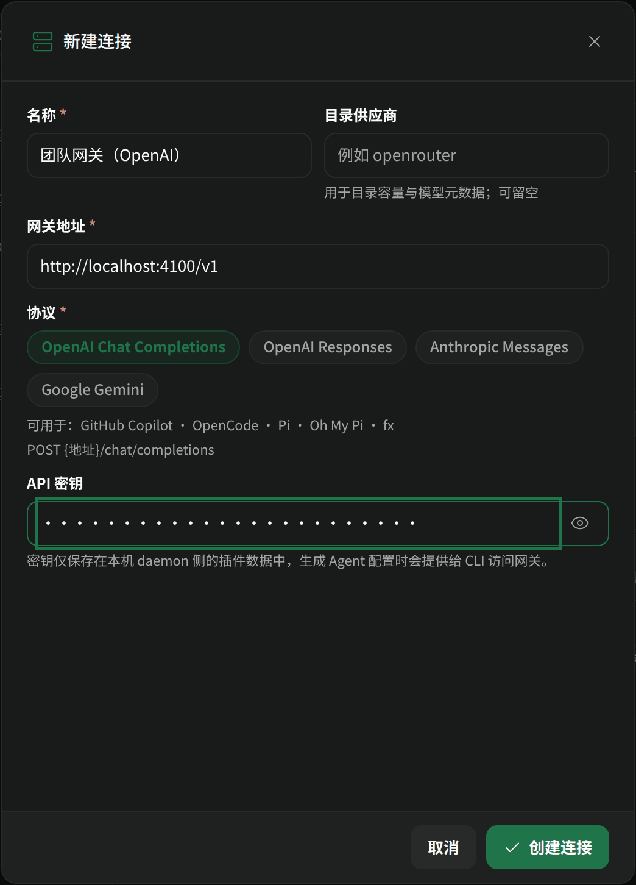
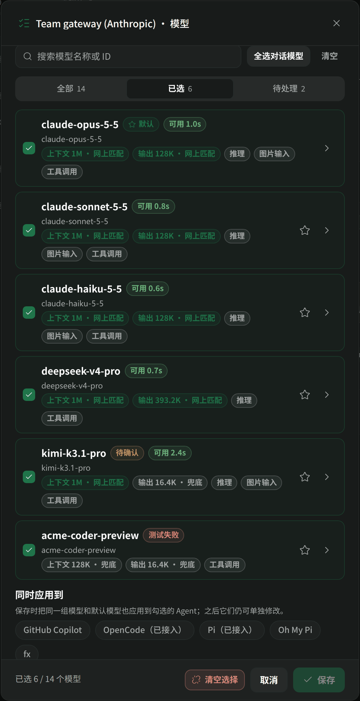
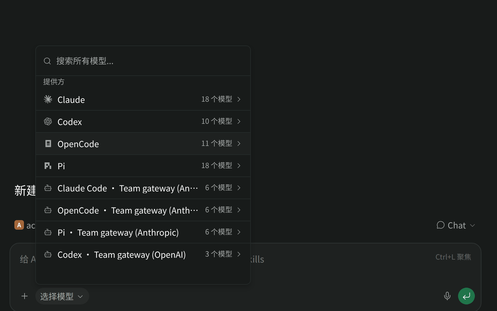

<div align="center">



<p>
  <a href="./README.md">English</a> | <strong>简体中文</strong>
</p>

<p>
  <a href="https://github.com/LucasLan666666/paseo-providers-manager/actions/workflows/ci.yml"></a>
  = 0.17.4" />
  <a href="https://github.com/LucasLan666666/paseo-providers-manager/releases/tag/v0.1.0"></a>
  <a href="./LICENSE"></a>
</p>

<p>
  <strong>一次配置共享 AI 网关连接，统一接入 <a href="https://paseo.sh">Paseo</a> 中的各类编码 Agent。</strong><br />
  自动拉取网关模型目录，基于 <a href="https://models.dev">models.dev</a> 匹配上下文窗口与最大输出上限，并一键生成可用于新建会话选择器的 Paseo Provider。
</p>

</div>

---

## 为什么需要 Providers Manager

每个编码 Agent CLI 管理自定义网关、API Key 和模型上限的方式各不相同——环境变量、JSON 模型表、自定义 Provider 文件或独立配置目录。每当更换中转网关密钥、或想把刚发布的新模型同步到 Claude Code、Codex、OpenCode、Pi、Oh My Pi、Copilot、Antigravity 和 fx 时，逐个手改配置既繁琐又容易出错。

**Providers Manager** 在 Paseo 内部将**网关连接**与**各 Agent 的模型选择**解耦：

- **共享网关连接，一处修改全局生效** — 网关地址、协议、API Key 与模型参数保存在共享连接上；更换地址或密钥时，所有引用该连接的 Agent 配置同步更新。
- **按 Agent 独立选模型与默认模型** — 每个 Agent 可从兼容连接中勾选自己的对话模型子集并指定默认模型，在 Paseo 中自动生成独立 Provider（如 `Claude Code · OpenRouter`、`Oh My Pi · Local Gateway`）。
- **自动匹配 `models.dev` 容量与能力** — 保存或刷新连接时拉取网关模型列表，优先按厂商官方条目匹配上下文窗口、最大输出与能力标记（`推理`、`图片输入`、`工具调用`）。
- **清晰区分确定值与待确认项** — 精确匹配的值直接使用并标明来源；同系列推测、第三方目录或未公布输出上限的条目会标为**待确认**，支持逐条或一键采用。嵌入、重排、图像、音频、视频等非对话模型自动灰显且不可勾选。
- **零 Token 配置校验 + 实时连通性探针** — **测试全部模型**重新读取模型目录并检查实际生成的配置参数，不发推理请求、不消耗 Token；模型面板中的**发送测试请求**可向每个已选对话模型发送极短探针并就地显示结果。
- **变更不打断运行中会话** — 配置更新后，旧的生成目录会保留 7 天缓冲期再自动清理，避免正在运行的 Agent 会话中途丢失配置。
- **原生双语界面** — 默认跟随 Paseo 语言，支持在当前设备上单独切换**简体中文**或 **English**。

## 动态演示

<div align="center">
  
</div>

*选择 Agent、复用已有网关连接、勾选自动匹配上限的模型，并在 Paseo 新建会话选择器中直接使用生成的 Provider。*

## 工作原理



## 支持的 Agent

插件为每个 Agent 实现了契合其 CLI 机制的适配器：

| Agent | 支持协议 | 接入方式 |
| --- | --- | --- |
| **Claude Code** | Anthropic Messages | 写入网关启动配置；仅对 Claude Code 内置表不认识的模型或手动覆盖项写入容量上限。 |
| **Codex** | OpenAI Responses | 精确匹配的内置模型保留 Codex 自带上限与推理强度档位；支持按连接配置别名映射、允许档位与手动覆盖并写入生成的模型目录。 |
| **GitHub Copilot** | Chat Completions、Responses、Anthropic Messages | 通过 Copilot CLI 的自定义提供商（providers）配置文件接入网关。 |
| **OpenCode** | Chat Completions、Responses、Anthropic Messages | 逐模型写入上限与能力标记至私有配置与密钥文件，并在会话打开时按连接注入以隔离多网关。 |
| **Pi** | Chat Completions、Responses、Anthropic Messages | 逐模型写入上下文窗口、最大输出与能力标记。 |
| **Oh My Pi** | Chat Completions、Responses、Anthropic Messages | 逐模型写入上下文窗口、最大输出与能力标记。 |
| **Antigravity** | Gemini | 通过原生 `agy` ACP 会话接入 Gemini 兼容网关，并将网关模型映射到 `agy` 内置模型名（如 `gemini-4-argon`、`gemini-3.1-pro`，可选 `-low`/`-medium`/`-high`/`-xhigh`）。 |
| **fx** | Chat Completions、Responses、Anthropic Messages | 将网关与逐模型参数写入 fx 的 `settings.json`。 |
| **Muse Code / Hoplite** | 原生账号目录 | 暂无可验证的自定义推理网关接口，仅支持检查并使用其各自账号/项目的原生模型目录。 |

## 界面截图

<table>
  <tr>
    <td width="50%">
      
      <p align="center"><sub><strong>Agent 视图</strong> — 按 Agent 查看已接入连接、默认模型与启用状态。</sub></p>
    </td>
    <td width="50%">
      
      <p align="center"><sub><strong>共享连接库</strong> — 集中维护网关连接、刷新过期目录并查看各 Agent 引用情况。</sub></p>
    </td>
  </tr>
  <tr>
    <td width="50%">
      
      <p align="center"><sub><strong>连接表单</strong> — 配置协议、网关地址、API Key 及可选目录供应商提示。</sub></p>
    </td>
    <td width="50%">
      
      <p align="center"><sub><strong>模型面板</strong> — 查看匹配来源、采用待确认建议、手动覆盖参数或发送测试请求。</sub></p>
    </td>
  </tr>
</table>

<div align="center">
  
  <p><sub><strong>新建会话选择器</strong> — 启用的 Agent + 连接组合会立即作为独立 Provider 出现。</sub></p>
</div>

## 安装指南

### 环境要求

- 目标 daemon 主机已安装 **Paseo `>= 0.17.4`**。
- 目标 daemon 已开启插件支持（在 **设置 → 插件** 中打开 **启用插件**，或在 daemon `config.json` 中设置 `pluginsEnabled: true`）。
- daemon 主机已安装你计划配置的编码 Agent 对应 CLI。

### 通过 CLI 安装（立即可用）

直接从 GitHub 仓库安装：

```bash
paseo plugin add git:LucasLan666666/paseo-providers-manager
```

如需固定到指定发布标签：

```bash
paseo plugin add git:LucasLan666666/paseo-providers-manager --ref v0.1.0
```

确认插件已正常运行：

```bash
paseo plugin ls
```

### 在 Paseo 应用内安装

1. 在目标主机打开 **设置 → 插件**。
2. 在 **插件源（Plugin source）** 中粘贴 `git:LucasLan666666/paseo-providers-manager`。
3. 点击 **安装插件**。

> **Paseo 官方插件市场**：本项目已提交至官方插件注册表（`getpaseo/plugins`）。审核通过并在 [paseo.sh/plugins](https://paseo.sh/plugins) 正式上架后，也可通过 `paseo plugin add LucasLan666666/providers-manager` 安装官方审核固定版本。

## 快速上手

1. **打开 Providers Manager**：从 Paseo 侧边栏点击 **Providers Manager**，或在命令中心搜索 `Providers Manager` / `提供商`。
2. **添加网关连接**：在某个 Agent 页面或**连接库**标签页点击添加连接，填写名称、协议、网关地址与 API Key。保存后会自动读取网关模型列表并通过 `models.dev` 匹配上限。
3. **选择模型与参数**：勾选希望显示在新建会话选择器中的对话模型，设置默认模型，按需采用或调整**待确认**上限；也可点击**发送测试请求**验证端到端连通性。
4. **新建会话**：打开 Paseo 新建会话选择器，即可直接选用新生成的 Provider（命名格式为 `<Agent> · <连接名称>`）。

## 配置与行为说明

### 网关地址规则

- **OpenAI 兼容协议**（`chat`、`responses`）：地址按填写的**原样使用**，插件不会自动补 `/v1`。
- **Anthropic 与 Gemini 协议**（`anthropic`、`gemini`）：既可填写主机根地址，也可带版本路径；适配器会按各自客户端约定补全 API 路径（`/v1/messages`、`/v1beta/models`）。

### 模型上限、默认值与自动刷新

- **OpenAI 计费档位**：OpenAI 模型默认采用 `272K` 上下文计费档位，可针对单个模型切换为完整窗口。
- **兜底上限**：网关与 `models.dev` 均查不到的模型使用连接的兜底设置（默认上下文 `128K` / 最大输出 `16K`，可修改）。
- **手动值优先**：手动填写的上限始终优先生效；若后续线上目录值发生变化，界面会保留对比供你选择。自动计算的最大输出不会达到或超过上下文窗口。
- **过期目录自动刷新**：超过 **24 小时**未刷新的连接会标记为过期，并在打开管理页时自动刷新。

### 语言设置

在 **设置 → 插件 → Providers Manager**（或命令中心搜索 **语言**）中可选择 **跟随 Paseo**、**简体中文** 或 **English**，设置保存在当前设备。

## 数据与安全

- **密钥存储**：连接 API Key 以明文保存在 daemon 主机的受限插件数据目录（`$PASEO_HOME/plugin-data/paseo-providers-manager/`）；各 CLI 的启动配置也可能在 Paseo 配置或生成的本地目录中包含运行所需的密钥。
- **密钥不回传界面**：已保存的 API Key 不会返回给 Paseo 客户端管理页。
- **安全的连接复制**：复制连接时，仅当新地址与原地址的域名和端口完全一致时才会沿用原密钥。
- **网络请求范围**：网关仅接收模型目录请求、用户主动触发的测试请求以及已启用 Agent 的正常模型请求；`models.dev` 查询使用独立无凭据请求。
- **生成目录清理**：配置变更后，旧的生成目录会保留 **7 天**，避免运行中的会话丢失配置，到期后由插件自动清理未被引用的目录。

## 本地开发

```bash
git clone https://github.com/LucasLan666666/paseo-providers-manager.git
cd paseo-providers-manager
npm install
npm run typecheck
npm test
```

将本地目录安装到 Paseo daemon 进行调试：

```bash
paseo plugin install /absolute/path/to/paseo-providers-manager
paseo plugin ls
```

### 目录结构

```text
├── paseo-plugin.json     # 插件清单、市场展示元数据与多语言翻译
├── OVERVIEW.md           # Paseo 插件市场详情页（英文）
├── OVERVIEW.zh-CN.md     # Paseo 插件市场详情页（简体中文）
├── index.client.tsx      # Paseo 客户端入口（页面、侧边栏、命令中心、语言设置）
├── index.server.ts       # Paseo daemon 服务端入口（RPC 处理器）
├── client/               # 跨平台 React Native UI 组件与状态 Hook
├── server/               # 网关目录抓取、models.dev 匹配、各 Agent 适配器与存储
├── shared/               # 共享 Zod RPC 契约、协议定义、容量规则与国际化
├── tests/                # 单元测试与集成测试（tsx --test）
└── assets/               # 插件图标、双语 Banner、真实截图与动态演示 GIF
```

## 开源协议

本项目基于 [MIT License](./LICENSE) 开源。
